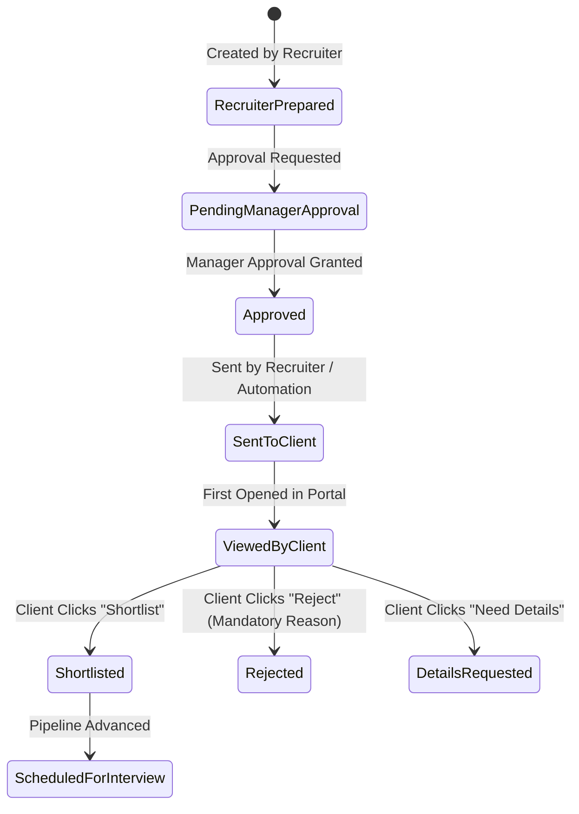

# Client Review Workflow & Decision State Machine (Prompt 22)

## Submission Lifecycle from Client Viewpoint
Submissions undergo a strict multi-step workflow before becoming visible to client contacts:

### 1. Visibility Gate
A candidate profile only surfaces in the Client Portal if:
- `approvalStatus IN ['APPROVED', 'APPROVAL_NOT_REQUIRED']`
- `sendState IN ['SENT', 'VIEWED_BY_CLIENT', 'CLIENT_REVIEWED']`
- Associated job is currently in an active or paused state (closed jobs archive submissions).

### 2. Client Decisions
- **Shortlist (`POST /api/client-portal/submissions/:id/shortlist`)**:
  - Updates `clientDecisionAt` and appends an entry to `clientDecisionHistory`.
  - Emits an internal audit event.
- **Reject (`POST /api/client-portal/submissions/:id/reject`)**:
  - Requires a mandatory rejection reason (min 5 characters) validated server-side by Zod.
  - Rejection details are logged in `clientDecisionReason` and `clientDecisionHistory`.
- **Request Details (`POST /api/client-portal/submissions/:id/request-details`)**:
  - Creates an internal recruiter task / feedback note asking for supplementary candidate documentation.
- **Team Feedback (`POST /api/client-portal/submissions/:id/feedback`)**:
  - Confidential communication sent directly to the assigned account recruiters.
  - Candidates never receive these messages.
