# HireFlow ATS & Recruitment CRM — Entity Relationship Diagram (ERD)

> **Document Version:** 1.0 (Prompt 4 Milestone)  
> **Database:** PostgreSQL (Hosted on Supabase) via Prisma ORM  
> **Package:** `@hireflow/db`

---

## 1. High-Level Architecture Overview

The HireFlow ATS database architecture is normalized and designed for enterprise multi-tenant recruitment agency operations. It strictly enforces:
- **UUID Primary Keys** across all tables.
- **Audit Columns:** `createdAt`, `updatedAt`, and `createdById`.
- **Soft Deletion:** Candidate, Client, Job, and User soft-deletes with `isArchived` and reason tracking.
- **Data Protection:** Candidate internal notes and agency margins are separated from Client-visible models.
- **Financial Accuracy:** All salary, fee percentages, and margins use PostgreSQL `Decimal` types.

---

## 2. Complete Entity Relationship Diagram (Mermaid)

```mermaid
erDiagram
    ORGANIZATION ||--o{ USER : "has"
    ORGANIZATION ||--o{ TEAM : "has"
    ORGANIZATION ||--o{ CLIENT : "manages"
    ORGANIZATION ||--o{ JOB : "hosts"
    ORGANIZATION ||--o{ CANDIDATE : "owns"

    USER ||--o{ SESSION : "authenticates"
    USER ||--o{ TEAM : "manages"
    USER ||--o{ CANDIDATE : "sources/owns"
    USER ||--o{ JOB : "leads"
    USER ||--o{ JOB_ASSIGNMENT : "assigned"
    USER ||--o{ CLIENT_ACCESS : "granted"
    USER ||--o{ INTERVIEW_PANEL_MEMBER : "participates"
    USER ||--o{ INTERVIEW_FEEDBACK : "submits"
    USER ||--o{ SUBMISSION_APPROVAL : "approves"
    USER ||--o{ TASK : "executes"
    USER ||--o{ NOTIFICATION : "receives"
    USER ||--o{ DAILY_ACTIVITY : "logs"

    CLIENT ||--o{ CLIENT_CONTACT : "has"
    CLIENT ||--o{ CLIENT_DOCUMENT : "stores"
    CLIENT ||--o{ CLIENT_WORKFLOW : "configures"
    CLIENT ||--o{ JOB : "mandates"
    CLIENT ||--o{ CLIENT_ACCESS : "allows"
    CLIENT ||--o{ OPPORTUNITY : "generates"
    CLIENT ||--o{ MEETING : "schedules"
    CLIENT ||--o{ OFFER : "releases"
    CLIENT ||--o{ PLACEMENT : "billed"

    CLIENT_WORKFLOW ||--o{ CLIENT_STAGE : "defines"
    CLIENT_WORKFLOW ||--o{ SUBMISSION_RULE : "enforces"

    JOB ||--o{ JOB_ROUND : "configures"
    JOB ||--o{ JOB_ASSIGNMENT : "allocates"
    JOB ||--o{ JOB_STATUS_HISTORY : "tracks"
    JOB ||--o{ APPLICATION : "receives"

    CANDIDATE ||--o{ CANDIDATE_NOTE : "has"
    CANDIDATE ||--o{ CANDIDATE_TAG : "tagged"
    CANDIDATE ||--o{ CANDIDATE_DOCUMENT : "attaches"
    CANDIDATE ||--o{ APPLICATION : "applies"

    APPLICATION ||--o{ APPLICATION_STAGE_HISTORY : "progresses"
    APPLICATION ||--o{ INTERVIEW : "schedules"
    APPLICATION ||--o{ SUBMISSION : "presents"
    APPLICATION ||--o{ OFFER : "receives"
    APPLICATION ||--o| PLACEMENT : "closes"
    REJECTION_REASON ||--o{ APPLICATION : "categorizes"

    INTERVIEW ||--o{ INTERVIEW_PANEL_MEMBER : "includes"
    INTERVIEW ||--o{ INTERVIEW_FEEDBACK : "collects"
    INTERVIEW ||--o{ SLOT_INVITATION : "generates"
    SLOT_INVITATION ||--o{ SLOT_OPTION : "offers"

    SUBMISSION ||--o{ SUBMISSION_APPROVAL : "signs"

    THREAD ||--o{ MESSAGE : "contains"
    IMPORT_BATCH ||--o{ IMPORT_ITEM : "processes"
    REPORT_DEFINITION ||--o{ SCHEDULED_REPORT : "automates"
    SCHEDULED_REPORT ||--o{ REPORT_DELIVERY : "dispatches"

    ORGANIZATION {
        string id PK
        string name
        string slug UK
        string domain
        json settings
        string status
        datetime createdAt
        datetime updatedAt
    }

    USER {
        string id PK
        string email UK
        string name
        string passwordHash
        enum role
        string organizationId FK
        string managerId FK
        string teamId FK
        boolean twoFactorEnabled
        datetime lastLoginAt
        boolean isArchived
    }

    CANDIDATE {
        string id PK
        string code UK
        string name
        string email
        string phone
        string currentTitle
        string currentCompany
        decimal experienceYears
        decimal currentSalary
        decimal expectedSalary
        string noticePeriod
        string location
        string[] skills
        string ownerId FK
        string organizationId FK
        boolean isArchived
    }

    CLIENT {
        string id PK
        string code UK
        string legalName
        string industry
        string website
        string location
        string relationshipOwnerId FK
        string organizationId FK
        enum status
        string commercialTerms
        decimal feePercentage
        boolean isArchived
    }

    JOB {
        string id PK
        string code UK
        string clientId FK
        string title
        string ownerId FK
        string hiringManagerContactId FK
        string organizationId FK
        int openings
        string location
        decimal salaryMin
        decimal salaryMax
        enum status
        boolean isArchived
    }

    APPLICATION {
        string id PK
        string candidateId FK
        string jobId FK
        string stageId
        enum status
        string rejectionReasonId FK
        datetime appliedAt
    }

    INTERVIEW {
        string id PK
        string applicationId FK
        string roundId FK
        datetime scheduledAt
        int duration
        string mode
        string provider
        string meetingLink
        enum outcome
    }

    SUBMISSION {
        string id PK
        string code UK
        string applicationId FK
        int version
        string standardProfileVersion
        enum approvalStatus
        string approvedById
        datetime sentAt
        string clientDecision
        string clientFeedback
    }

    OFFER {
        string id PK
        string applicationId FK
        string clientId FK
        decimal offeredSalary
        datetime joiningDate
        enum status
        string offerDocumentUrl
    }

    PLACEMENT {
        string id PK
        string applicationId FK,UK
        string clientId FK
        string feeBasis
        decimal feeAmount
        string paymentTerms
        datetime dueDate
        enum paymentStatus
        datetime paidAt
    }

    AUDIT_LOG {
        string id PK
        string actorId
        string action
        string entity
        string entityId
        json before
        json after
        string ipAddress
        datetime createdAt
    }
```

---

## 3. Core Database Modules

### Module A: Organization & Access Management
- **Organization:** Master tenant model for Aureva Capital.
- **User:** Hierarchical user model supporting Manager-Subordinate reporting (`managerId`) and Team assignment.
- **Team:** Functional agency desks (e.g., Tech Delivery, Enterprise Sourcing).
- **Session & Invitation:** Security lifecycle models for browser tokens and user invites.
- **ClientAccess:** Granular authorization mapping client portal users (`CLIENT` role) to allowed company jobs.

### Module B: Candidate Management
- **Candidate:** Comprehensive talent pool with soft-deletion, resume parser storage paths, and indexed skills.
- **CandidateNote & Tag:** Searchable candidate annotations and skill/domain tags.
- **CandidateDocument:** Versioned CV/resume storage paths (referencing Supabase `resumes` bucket).
- **CustomFieldDefinition & Value:** Dynamic schema extensibility without database migrations.

### Module C: Client CRM
- **Client:** Client accounts with private internal commercial fee terms (`feePercentage`) protected from client view.
- **ClientContact:** Hiring managers and billing POCs.
- **ClientWorkflow & Stage:** Client-specific hiring stages and submission approval rules.

### Module D: Job Management
- **Job:** Open mandate records with salary bands, openings, and pipeline tracking.
- **JobRound:** Custom interview rounds per job (Screening, Technical, Leadership).
- **JobAssignment:** Recruiter workload allocation and assignment audit.

### Module E: Pipeline & Applications
- **Application:** Candidate-to-job pairing with strict `@@unique([candidateId, jobId])` constraint to prevent duplicate active applications.
- **ApplicationStageHistory:** Immutable state transition logs for funnel analytics.
- **RejectionReason:** Categorized drop-off analytics.

### Module F: Interview Management
- **Interview:** Multi-round scheduling with video coordinates (Google Meet/Zoom) and outcome statuses.
- **InterviewPanelMember & Feedback:** Multi-interviewer scorecards with structured recommendations.
- **SlotInvitation & Option:** Candidate self-scheduling workflows.

### Module G: Submissions, Offers & Placements
- **Submission & Approval:** Manager-gated standardized candidate profiles sent to clients.
- **Offer:** Official salary offer letter tracking with acceptance milestones.
- **Placement:** Closed deals with agency fee calculations (`Decimal(12,2)`) and payment tracking.

### Module H, I & J: CRM, Automation & Audit
- **Opportunity & Meeting:** Business development sales tracking for prospective clients.
- **Communication Threads & Messages:** Email, WhatsApp, and SMS interaction histories.
- **Tasks & Notifications:** Recruiter daily to-do items and alerts.
- **ImportBatch & DuplicatePair:** High-volume resume parsing and duplicate detection.
- **AuditLog:** High-throughput compliance trail with actor, before/after JSON snapshots, and IP logging.
