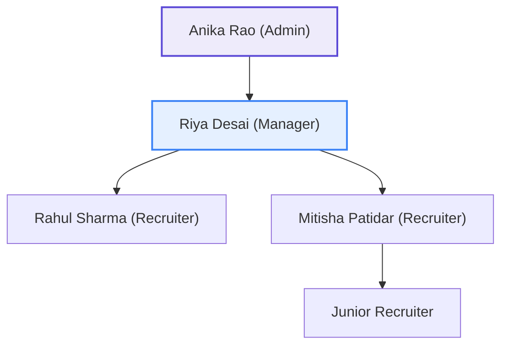

# Reporting Lines & Cycle Detection

## Overview
HireFlow enforces a strict hierarchical reporting structure across internal agency staff. Managers supervise direct reporting recruiters, review client submissions, and monitor delivery KPIs.

## Business & Hierarchy Rules

### 1. Manager Eligibility
Only active staff members holding supervisory roles are eligible to manage other team members:
- `ADMIN`: Top-level agency leadership and workspace owners.
- `MANAGER`: Talent delivery managers and desk heads.
- `RECRUITER`: Cannot have subordinate reports.
- `CLIENT` & `CANDIDATE`: External portal roles, completely excluded from internal management.
- Inactive (`DISABLED`) or archived (`isArchived = true`) users are disqualified from acting as managers.

### 2. Cycle Detection Algorithm (`wouldCreateReportingCycle`)
To prevent infinite loops, deadlocks, and organizational paradoxes, HireFlow executes cycle detection before persisting any reporting line change:



#### Traversal Algorithm:
1. If `proposedManagerId` is null, the user is assigned as top-level (no cycle possible).
2. If `userId === proposedManagerId`, self-reporting is rejected immediately.
3. The algorithm initializes a `visited` set with `{userId}` and traverses upward from `proposedManagerId` following `managerId` pointers:
   ```typescript
   let currentId = proposedManagerId;
   while (currentId) {
     if (visited.has(currentId)) {
       return true; // Cycle detected!
     }
     visited.add(currentId);
     currentId = getManagerOf(currentId);
   }
   ```
4. Both an asynchronous implementation (for database checks) and an in-memory synchronous implementation (`wouldCreateReportingCycleSync` for live client-side validation in the UI) are available in `@hireflow/shared`.

### 3. Subordinate Scoping for Managers
When a Manager requests candidate profiles, job assignments, or team performance reports, the authorization engine automatically resolves their team scope:
```typescript
const subordinateIds = await prisma.user.findMany({
  where: { managerId: manager.id, isArchived: false },
  select: { id: true }
});
```
Managers can only review submissions and candidates assigned to their direct subordinates or managed team desk.
