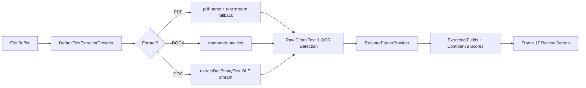

# Resume Parsing Pipeline & Field Confidence

## Overview
HireFlow ATS features an intelligent, multi-stage resume parsing engine that transforms raw PDF and Word documents into structured candidate profiles without ever saving unverified data.

---

## Architecture Pipeline

---

## Extracted Fields & Data Mapping

| Field | Type | Extraction Technique | Confidence Rules |
|---|---|---|---|
| **Full Name** | `string` | Top header analysis, honorific stripping, name capitalization | `HIGH_CONFIDENCE` (>= 0.85) when found in header |
| **Email** | `string` | RFC-5322 compliant regex with domain validation | `HIGH_CONFIDENCE` (0.98) on valid TLD |
| **Phone** | `string` | E.164 normalization, Indian standard (`+91` 10-digit mobile) | `HIGH_CONFIDENCE` (0.94) on 10+ digits |
| **Current Title** | `string` | Positional role titles (Engineer, Architect, Manager, etc.) | `HIGH_CONFIDENCE` (0.85) or `NEEDS_REVIEW` |
| **Current Company**| `string` | Employer extraction from experience timeline | `HIGH_CONFIDENCE` (0.80) or `NEEDS_REVIEW` |
| **Experience Years**| `number`| Explicit year counts or date interval delta computation | `HIGH_CONFIDENCE` (0.90) |
| **Current Salary** | `number`| Currency detection (`₹`, `INR`, `Lakhs`, `CTC`) | `HIGH_CONFIDENCE` (0.85) or `MISSING` |
| **Expected Salary**| `number`| Expected compensation parsing | `HIGH_CONFIDENCE` (0.85) or `MISSING` |
| **Location** | `string` | Top Indian tech hubs (Bengaluru, Mumbai, Pune, Delhi NCR, etc.) | `HIGH_CONFIDENCE` (0.90) |
| **Notice Period** | `string` | Immediate, 15 days, 30 days, 60 days, 90 days | `HIGH_CONFIDENCE` (0.90) |
| **Skills** | `string[]` | Dictionary match against 150+ software & recruitment keywords | Distinct deduplicated array |

---

## Field Confidence Indicator States

Each extracted field is displayed in the UI with a confidence indicator matching Figma Frame 17:

1. **`HIGH_CONFIDENCE` (>= 0.80)**: Green badge indicating high statistical certainty.
2. **`NEEDS_REVIEW` (0.50 - 0.79)**: Amber badge alerting the recruiter to verify the extracted text.
3. **`MISSING` (0.00)**: Gray pill prompting the recruiter to manually supply the value.
4. **`MANUALLY_EDITED`**: Indicator that the recruiter altered the parsed suggestion.

---

## OCR Fallback Detection

When an uploaded document contains scanned images or flattened vector graphics:
- If extracted text contains fewer than 50 printable characters across multiple pages, the `ocrTriggered` flag is set to `true`.
- The user is notified with an informational banner: `"Low text density detected. This document may be scanned or image-based. Manual review is recommended."`
