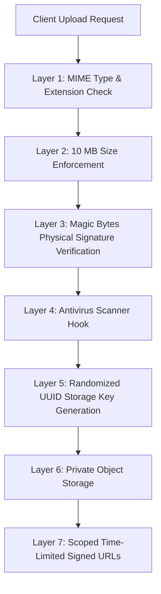

# Resume Upload & Storage Security Architecture

## Security Objectives
Resumes uploaded to HireFlow ATS represent sensitive Personally Identifiable Information (PII) and potential vectors for malicious files (polyglots, embedded macros, executable droppers). This document details the defense-in-depth measures enforced across the platform.

---

## Defense-in-Depth Layered Architecture



---

## 1. Magic Byte Validation
Never trust client-supplied `content-type` headers or file extensions. The `validateFileSecurity(buffer, fileName)` utility inspects the first 8 to 16 bytes of every buffer:

```typescript
// PDF magic bytes: %PDF- (0x25 0x50 0x44 0x46)
if (ext === 'pdf') {
  if (buffer.subarray(0, 4).toString('ascii') !== '%PDF') {
    return { valid: false, reason: 'File content does not match standard PDF header signature.' };
  }
}

// DOCX magic bytes: PK\x03\x04 (0x50 0x4B 0x03 0x04)
if (ext === 'docx') {
  if (buffer[0] !== 0x50 || buffer[1] !== 0x4B || buffer[2] !== 0x03 || buffer[3] !== 0x04) {
    return { valid: false, reason: 'File content does not match standard DOCX zip container signature.' };
  }
}

// DOC magic bytes: OLE header 0xD0 0xCF 0x11 0xE0 0xA1 0xB1 0x1A 0xE1
if (ext === 'doc') {
  const oleSignature = [0xD0, 0xCF, 0x11, 0xE0, 0xA1, 0xB1, 0x1A, 0xE1];
  for (let i = 0; i < 8; i++) {
    if (buffer[i] !== oleSignature[i]) {
      return { valid: false, reason: 'File content does not match standard Word 97-2003 OLE signature.' };
    }
  }
}
```

---

## 2. Antivirus Scanner Integration
An antivirus provider interface (`AntivirusScannerProvider`) verifies incoming buffers prior to storage:

- **Development / Mock (`MockAntivirusScannerProvider`)**:
  - Scans for standard EICAR anti-malware test signature strings (`X5O!P%@AP[4\PZX54(P^)7CC)7}$EICAR...`).
  - Blocks PE executables (`MZ` magic headers) disguised with document extensions.
  - Blocks shell scripts disguised with document extensions (`#!/bin/sh`, `#!/bin/bash`).
- **Production (`ClamAVScannerProvider`)**:
  - Streams file buffers to a ClamAV daemon (`clamd`) running inside the VPC over TCP port 3310.
  - Rejects infected files with security incident logs and HTTP 422 Unprocessable Entity.

---

## 3. Storage Privacy & Access Isolation
- **No Public Buckets**: Resumes are stored in private S3/Supabase storage buckets with all public read access disabled.
- **Randomized Keys**: Storage keys are generated as `resumes/<uuid>-<sanitized-filename>` to prevent path traversal or enumerative attacks.
- **Access Delegation**: Document download requests require an authenticated recruiter session with resource-level read permission. URLs are generated as time-limited signed URLs (15-minute expiry).
- **Candidate & Client Portal Restrictions**: Candidate internal notes, salary benchmarks, and recruiter margins are strictly excluded from client portal and candidate portal endpoints.
