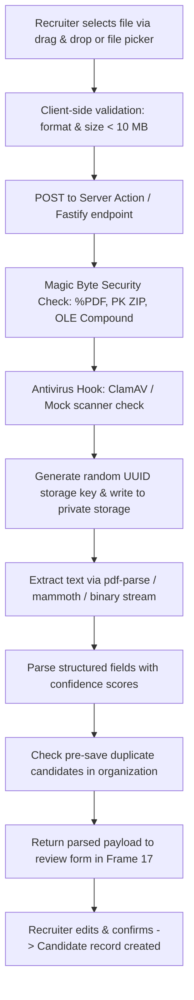

# Resume Upload Architecture & Specifications

## Overview
HireFlow ATS provides secure resume upload capabilities as part of Phase 1 Core ATS Foundation (Figma Frame 17). The upload pipeline handles multi-format file ingestion, strict security checks, file-header magic-bytes validation, antivirus scanning hooks, and private object storage persistence.

---

## Technical Specifications

| Parameter | Specification |
|---|---|
| **Supported File Formats** | PDF (`.pdf`), Word 2007+ OpenXML (`.docx`), Word 97-2003 Binary (`.doc`) |
| **Maximum File Size** | 10 MB (10,485,760 bytes) |
| **Validation Layer** | Dual: Client-side validation + Server-side magic-bytes & size verification |
| **Storage Destination** | Private object storage (`LocalStorageProvider` in dev/testing, `S3StorageProvider` in production) |
| **Public URL Access** | **Strictly Forbidden**; Files are accessed only via authenticated, short-lived signed URLs |
| **Checksum Generation** | SHA-256 hash computed on upload for deduplication and file integrity validation |

---

## Upload & Parsing Flow

---

## File Format Magic Bytes Verification

File extensions and browser-supplied MIME types can be spoofed. HireFlow ATS verifies file signatures against physical byte headers before accepting the payload:

- **PDF**: Must begin with `%PDF-` (`0x25 0x50 0x44 0x46`).
- **DOCX**: Must begin with standard PK Zip header (`0x50 0x4B 0x03 0x04`).
- **DOC**: Must begin with Microsoft Compound Document (OLE) header (`0xD0 0xCF 0x11 0xE0 0xA1 0xB1 0x1A 0xE1`).
- **Executables & Scripts**: Files matching PE headers (`MZ`), ELF (`0x7F 0x45 0x4C 0x46`), or shell shebangs (`#!`) are rejected immediately with security audit alerts.

---

## Drag-and-Drop User Experience (Frame 17)

1. **Active Dragging State**: The dropzone activates with `#EEEBFB` tint and dashed `#5B49D6` border.
2. **Uploading & Extracting State**: A spinner with "Extracting candidate profile..." appears while security validation and text parsing run.
3. **Review State**: Once extracted, the dropzone is replaced with the **Resume uploaded** card showing file name, size, upload timestamp, and actions to Replace or Remove.
4. **Manual Entry Alternative**: Recruiters can bypass resume upload at any time by clicking "Enter manually" or "Switch to manual entry".
