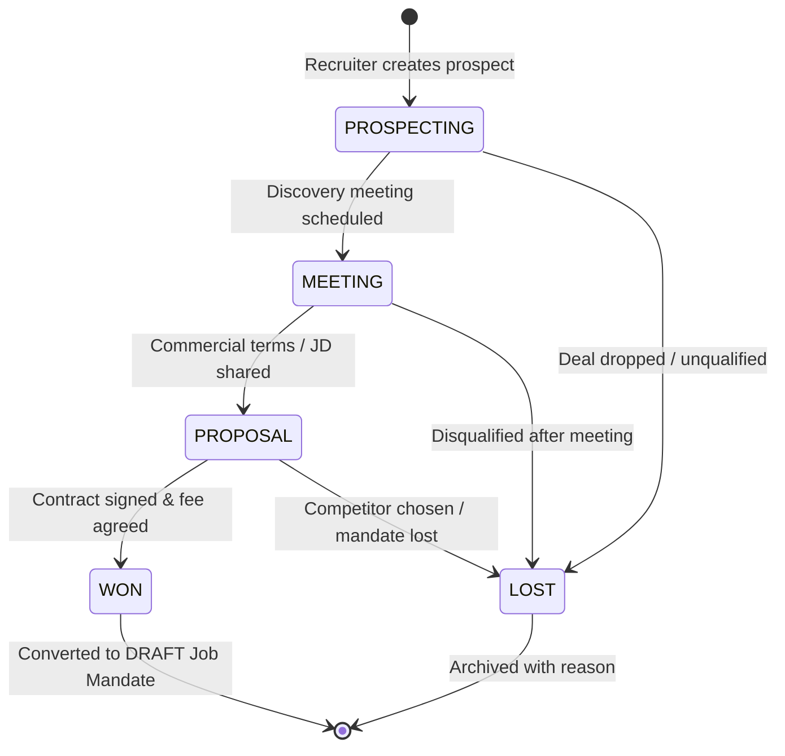

# Sales Opportunities & Lifecycle

**Module:** Sales CRM & Mandate Management  
**Playbook Phase:** Phase 1 — Prompt 15  
**Figma Reference:** Frame 23 — Sales Opportunities & Meetings  

## 1. Opportunity Lifecycle State Machine

Sales opportunities progress through strict, deterministic stages validated by `isValidStageTransition()` in `@hireflow/shared`:



## 2. Permitted Stage Transitions

- **PROSPECTING** -> `MEETING`, `LOST`
- **MEETING** -> `PROPOSAL`, `LOST`
- **PROPOSAL** -> `WON`, `LOST`
- **WON** -> Terminal stage (Ready for conversion into Job)
- **LOST** -> Terminal stage (Archived)

Any invalid jump (such as `PROSPECTING` directly to `WON` without discovery and proposal) is rejected with HTTP 400.

## 3. Data Model & Privacy

```prisma
model Opportunity {
  id                   String        @id @default(uuid())
  title                String
  companyName          String
  clientId             String?
  primaryContactId     String?
  contactName          String?
  contactEmail         String?
  contactPhone         String?
  industry             String?
  location             String?
  estimatedOpenings    Int           @default(1)
  estimatedValue       Decimal?      @db.Decimal(12, 2)
  nextFollowUpAt       DateTime?
  stage                OpportunityStage @default(PROSPECTING)
  priority             String        @default("MEDIUM")
  convertedJobId       String?       @unique
  convertedAt          DateTime?
  convertedById        String?
  ownerId              String
  organizationId       String
  isArchived           Boolean       @default(false)
}
```

Internal margin and fee fields are serialized safely via `serializeOpportunitySafe()` to prevent data leaks.
